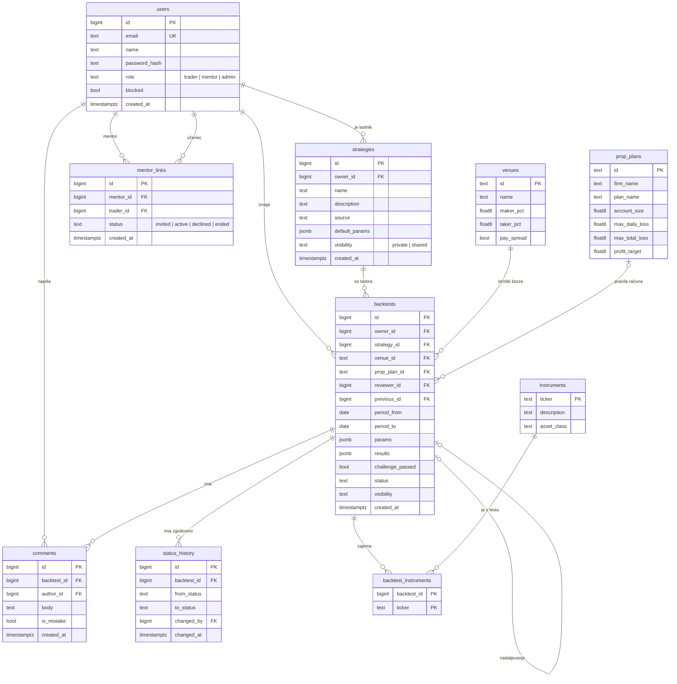

## Podatkovni model
Platforma uporablja relacijsko podatkovno bazo PostgreSQL ter lokalni DuckDB za hitro delo z zgodovinskimi podatki v .parquet formatu. Vsi osebni podatki, profili in statistika so ustrezno zavarovani znotraj podatkovne baze.

## Entitete
Model ima pet glavnih entitet, ki jih ustvarjajo uporabniki, in tri entitete, ki jih vzdržuje administrator.

| Skupina | Entitete |
|---|---|
| Glavne | `users`, `strategies`, `backtests`, `comments`, `mentor_links` |
| Referenčne (administrator) | `instruments`, `venues`, `prop_plans` |
| Pomožne | `backtest_instruments`, `status_history` |

### users
Uporabnik platforme, ne glede na vlogo (trader, mentor, admin).

| Polje | Opis |
|---|---|
| `id` | Primarni ključ |
| `email` | E-naslov, enoličen, uporablja se za prijavo |
| `name` | Ime in priimek |
| `password_hash` | Zgoščeno geslo |
| `role` | `trader`, `mentor` ali `admin` |
| `blocked` | Ali je račun blokiran |
| `created_at` | Čas ustvarjanja |

### strategies
Trgovalna strategija, sistemska (obstoječa) ali naložena s strani trgovca.

| Polje | Opis |
|---|---|
| `id` | Primarni ključ |
| `owner_id` | Tuji ključ na `users`, prazen pri sistemskih strategijah |
| `name`, `description` | Naziv in opis |
| `source` | Vsebina ali koda strategije |
| `default_params` | Privzeti parametri (JSON) |
| `visibility` | `private` ali `shared` |
| `created_at` | Čas ustvarjanja |

### backtests
En test strategije (zagon na zgodovinskih podatkih). To je osrednja entiteta in nosilec delovnega procesa.

| Polje | Opis |
|---|---|
| `id` | Primarni ključ |
| `owner_id` | Tuji ključ na `users` (trgovec, ki je test izvedel) |
| `strategy_id` | Tuji ključ na `strategies` |
| `venue_id` | Tuji ključ na `venues` (borza, katere stroške upoštevamo) |
| `prop_plan_id` | Tuji ključ na `prop_plans`, neobvezen (pravila financiranega računa) |
| `previous_id` | Tuji ključ na `backtests`, neobvezen: test, iz katerega je nastal ta (po zahtevanih spremembah) |
| `reviewer_id` | Tuji ključ na `users` (mentor), neobvezen, nastavljen ob oddaji v pregled |
| `period_from`, `period_to` | Obdobje testa |
| `params` | Uporabljeni parametri strategije (JSON) |
| `results` | Povzetek rezultatov: donosnost, število poslov, največji padec kapitala (JSON) |
| `challenge_passed` | Ali je strategija opravila pravila financiranega računa, neobvezno |
| `status` | Stanje delovnega procesa (glej spodaj) |
| `visibility` | `private` ali `shared` |
| `created_at` | Čas ustvarjanja |

Vrednosti polja `status` ustrezajo delovnemu procesu iz datoteke 02: `draft`, `submitted`, `in_review`, `changes_requested`, `approved`, `withdrawn`.

### comments
Mentorjev komentar ali zabeležena napaka ob testu.

| Polje | Opis |
|---|---|
| `id` | Primarni ključ |
| `backtest_id` | Tuji ključ na `backtests` |
| `author_id` | Tuji ključ na `users` |
| `body` | Besedilo komentarja |
| `is_mistake` | Ali komentar pomeni zabeleženo napako |
| `created_at` | Čas ustvarjanja |

### mentor_links
Povezava med mentorjem in učencem (trgovcem), ki jo ustvari vabilo.

| Polje | Opis |
|---|---|
| `id` | Primarni ključ |
| `mentor_id` | Tuji ključ na `users` |
| `trader_id` | Tuji ključ na `users` |
| `status` | `invited`, `active`, `declined` ali `ended` |
| `created_at`, `updated_at` | Časa ustvarjanja in zadnje spremembe |

Par in povezava med mentorjem in trgovcem (`mentor_id`, `trader_id`) je enolična.

### Referenčne entitete
| Entiteta | Opis | Glavna polja |
|---|---|---|
| `instruments` | Finančno sredstvo | `ticker` (PK), `description`, `asset_class` (kriptovaluta, valutni par, indeks, zlato) |
| `venues` | Borza | `id` (PK), `name`, `maker_pct`, `taker_pct` (provizije), `pay_spread` |
| `prop_plans` | Pravila financiranega računa podjetja | `id` (PK), `firm_name`, `plan_name`, `account_size`, `max_daily_loss`, `max_total_loss`, `profit_target` |

### Pomožne entitete
| Entiteta | Namen | Polja |
|---|---|---|
| `backtest_instruments` | Povezava med testom in sredstvi (en test lahko zajema več sredstev) | `backtest_id` (PK, FK), `ticker` (PK, FK) |
| `status_history` | Zgodovina prehodov stanja testa, da je potek pregleda sledljiv | `id`, `backtest_id` (FK), `from_status`, `to_status`, `changed_by` (FK na `users`), `changed_at` |

## Povezave med entitetami
- En uporabnik (trgovec) ima več strategij in več testov.
- Ena strategija ima več testov.
- Test uporablja eno borzo, neobvezno en načrt financiranega računa in eno ali več sredstev.
- Test ima več komentarjev, vsak komentar napiše en uporabnik (mentor).
- Mentor ima več učencev, učenec ima hkrati samo enega aktivnega mentorja (prek `mentor_links`). Več mentorjev na učenca je kasnejša nadgradnja.
- Test ima več zapisov v zgodovini stanj.
- Test lahko nadaljuje prejšnji test (`previous_id`), kadar mentor zahteva spremembe.

## Pravila in omejitve
- `email` v `users` je enoličen, `role` ima le dovoljene vrednosti (trader, mentor, admin).
- Test sme v pregled oddati samo njegov lastnik in samo, če ima `mentor_links` s statusom `active`.
- Komentar sme dodati samo `reviewer_id` testa. Mentor ne more spreminjati polj `params` in `results`, kar zagotavlja aplikacijska logika.
- Teste in strategije z `visibility = private` vidi samo lastnik (mentor vidi teste svojih aktivnih učencev).

## ER diagram

