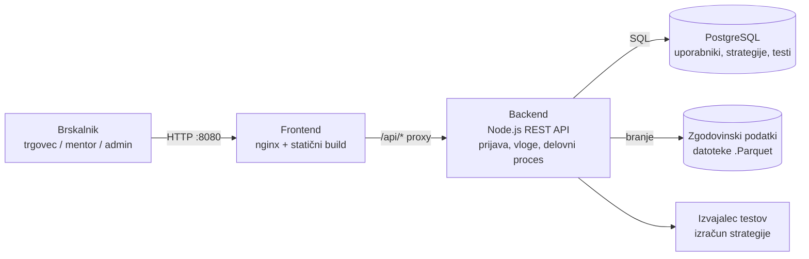

# Arhitektura in tehnološki sklad
Backtester je spletna REST aplikacija, ki za hranjenje podatkov hrani lokalni json DuckDB format in relacijsko bazo PostgreeSQL vzpostavljena v kontejnaziranem okolju Docker.

## Arhitektura
### Glavni deli sistema
| Del | Naloga |
|---|---|
| **Frontend** | Spletni vmesnik za vse tri vloge: prijava, izbira in nastavitev strategije, zagon testa, prikaz rezultatov, oddaja v pregled, mentorjev pregled in administracija. Nima poslovne logike. |
| **Backend** | Vmesnik Node.js REST (API). Preverja prijavo in vlogo, izvaja delovni proces pregleda testa, poganja teste (izračun strategije) in bere ter piše v bazo. |
| **Podatkovna baza** | PostgreSQL. Hrani uporabnike, strategije, teste, komentarje, povezave mentor–učenec in referenčne podatke (sredstva, borze, pravila financiranih računov). |
| **Zgodovinski podatki** | Cenovni podatki (svečke) so datoteke na disku, ki jih backend bere pri izvajanju testa. V bazi niso. |

### Komunikacija med deli
- Brskalnik pridobi frontend prek spletnega strežnika.
- Frontend kliče backend prek HTTP in JSON na poti `/api/*`.
- Backend se z bazo povezuje prek SQL. Frontend baze nikoli ne kliče neposredno.
- Izračun testa teče na backendu in ne dostopa do baze: backend mu poda potrebne podatke in prejme rezultat.

### Podatkovna baza
PostgreSQL hrani vse podatke, ki jih ustvarjajo uporabniki in administrator. Referenčni podatki (sredstva, borze, pravila) pa se naložijo iz lokalnih zapisov in se po potrebi posodabljajo preko skript. Podatki so nato hranjeni v trajnem Docker volumnu.

### Avtentikacija in upravljanje uporabnikov
- **Prijava:** 
Uporabnik se prijavi z e-naslovom in geslom. Geslo je v bazi shranjeno samo kot zgoščena vrednost (`password_hash`, algoritem bcrypt).
- **Seja:** 
Po uspešni prijavi backend izda podpisan žeton (JWT), ki ga brskalnik hrani v piškotku `httpOnly`. Frontend ga ne more prebrati s skriptami.
- **Pooblastila (vloge):** 
Backend ob vsakem zahtevku iz žetona prebere vlogo (`trader`, `mentor`, `admin`) in preveri, ali sme uporabnik izvesti dejanje. Preverjanje je vedno na backendu.
- **Omejitve vlog:** 
Poleg vloge backend preverja še omejitve, ki zagotavljajo, da zasebnih strategij in testov ne vidi nihče razen lastnika, mentor pa vidi samo teste svojih aktivnih učencev.
- **Upravljanje računov:** 
Administrator ustvarja in blokira račune ter dodeljuje vloge.

### REST Endpoints
Pri vsakem dostopu do endpointa, backend preveri prijavo, vlogo in lastništvo.

| Področje | Pot | Vloga |
|---|---|---|
| Prijava | `POST /api/auth/register`, `POST /api/auth/login`, `POST /api/auth/logout`, `GET /api/auth/me` | vsi |
| Strategije | `GET/POST /api/strategies`, `GET/PATCH/DELETE /api/strategies/:id` | trgovec |
| Testi | `POST /api/backtests` (zagon testa), `GET /api/backtests`, `GET /api/backtests/:id` | trgovec |
| Proces pregleda | `POST /api/backtests/:id/submit`, `/withdraw`, `/retest` | trgovec |
| | `POST /api/backtests/:id/start-review`, `/request-changes`, `/approve` | mentor |
| Komentarji | `GET/POST /api/backtests/:id/comments` | mentor (pisanje), trgovec (branje) |
| Povezava mentor–učenec | `POST /api/mentor-links` (vabilo), `POST /api/mentor-links/:id/accept`, `/decline`, `/end` | mentor, trgovec |
| Analitika | `GET /api/mentor/students/analytics` | mentor |
| Referenčni podatki | `GET/POST/PATCH/DELETE /api/admin/instruments`, `/venues`, `/prop-plans` | admin |
| Uporabniki | `GET /api/admin/users`, `PATCH /api/admin/users/:id` (blokada, vloga) | admin |

### Lokalni zagon
Projekt se zažene z enim ukazom v korenu repozitorija:

```sh
cp .env.example .env          # nastavitve in gesla (datoteka .env ni v gitu)
docker compose up --build     # zažene frontend, backend in bazo
```

Aplikacija je nato dosegljiva na `http://localhost:8080`. Zahteva samo `Docker`. Ob prvem zagonu backend ustvari shemo in naloži začetne podatke, administratorski račun pa se ustvari iz nastavitev v `.env`.

### Flowchart diagram


## Tehnološki sklad
| Del | Tehnologija |
|---|---|
| Frontend | TypeScript, Vite (build), nginx za strežbo statičnih datotek in proxy |
| Backend | Node.js 24 s TypeScriptom, vmesnik REST (JSON) |
| Podatkovna baza | PostgreSQL 16, povezava z odjemalcem `pg` in čistim SQL (brez ORM) |
| Zgodovinski podatki | Datoteke Parquet, ki jih bere DuckDB |
| Avtentikacija | Geslo z bcrypt ali argon2, JWT v piškotku `httpOnly` |
| Lokalni razvoj in zagon | Docker in Docker Compose, nastavitve v `.env` |
| Dodatno | Python skripte za posodabljanje zgodovinskih podatkov |

## Arhitekturne odločitve
| Odločitev | Utemeljitev |
|---|---|
| **Nadaljevanje obstoječega sklada** | Sklad (Vite, Node, PostgreSQL, Docker) je že implementiran in preizkušen, zato se čas porabi za vloge in delovni proces, ne za ponovno postavljanje osnove. |
| **PostgreSQL** | Podatki so močno povezani (uporabnik, strategija, test, komentar), zato so potrebni tuji ključi, transakcije in omejitve. Pri delovnem procesu je to pomembno, ker mora biti prehod stanja atomaren. |
| **Svečke ostanejo v datotekah** | Gre za velike količine podatkov, ki se samo berejo. Baza bi jih po nepotrebnem povečala in upočasnila. |
| **Tri ločene storitve** | Frontend, backend in baza so neodvisni: vsak se lahko zamenja ali razširi, lokalni zagon pa ostane en ukaz. |
| **Preverjanje vlog na backendu** | Frontendu ni mogoče zaupati. Vsako dejanje se preveri na strežniku glede na vlogo in lastništvo. |
| **JWT v piškotku `httpOnly`** | Žeton ni dostopen skriptam v brskalniku, kar zmanjša tveganje kraje s skriptami (XSS). Strežnik ne potrebuje seznama sej. |
| **Izračun testa ločen od baze** | Izvajalec dobi podatke od strežnika in vrne rezultat. Ločeno se lažje testira in ne more po nesreči spreminjati podatkov. |
| **Naložene strategije se izvajajo izolirano** | Strategijo naloži uporabnik, zato je njena koda nezaupanja vredna. Izvaja se v ločenem delavcu (worker), brez dostopa do baze, datotečnega sistema in omrežja, z omejitvijo časa in pomnilnika. |
| **Čisti SQL brez ORM** | Shema je majhna in jasna, `pg` in SQL zadoščata. Manj ogrodij pomeni manj odvisnosti. |

## Možnost nadaljnjega razvoja
Arhitektura je zasnovana tako, da se širi brez prenove jedra:

- Vsak del (frontend, backend, baza) je ločena storitev, zato se lahko posamezen del razširi ali zamenja.
- Referenčni podatki (sredstva, borze, pravila) so v bazi in jih administrator dopolnjuje brez posega v kodo.
- Delovni proces je zapisan s stanji in zgodovino prehodov (`status_history`), zato se lahko dodajo nova stanja ali pravila.
- Izvajalec testov je ločen od preostalega backenda, zato se lahko preseli v samostojno storitev ali vrsto opravil, ko bo treba teste poganjati vzporedno ali dalj časa.
- Predvidene nadgradnje (obvestila, samodejna optimizacija, več mentorjev na učenca, izvoz v PDF, lestvica strategij) so naštete v datoteki 02 in se navezujejo na obstoječi podatkovni model.