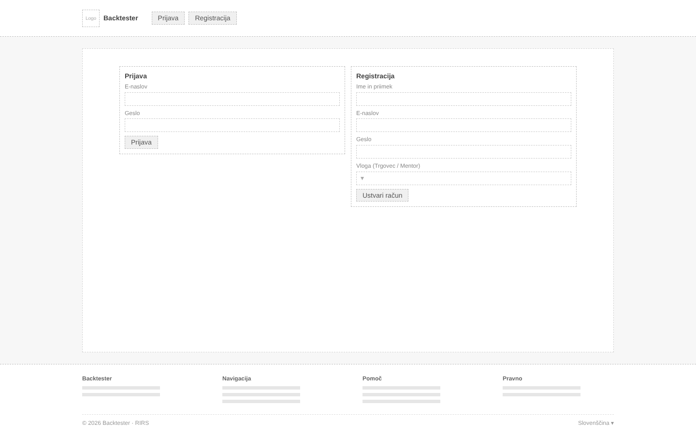
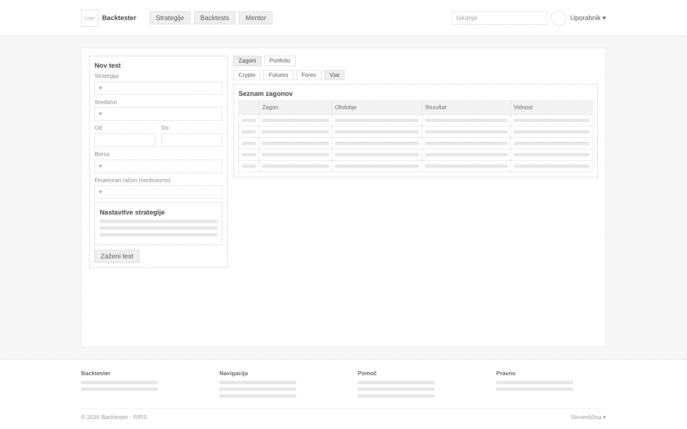
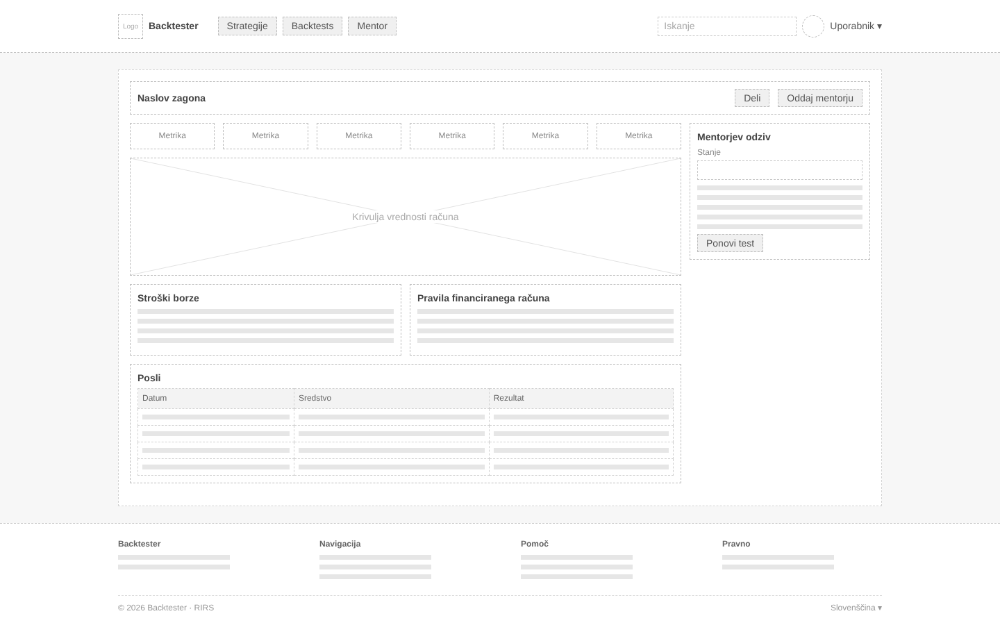
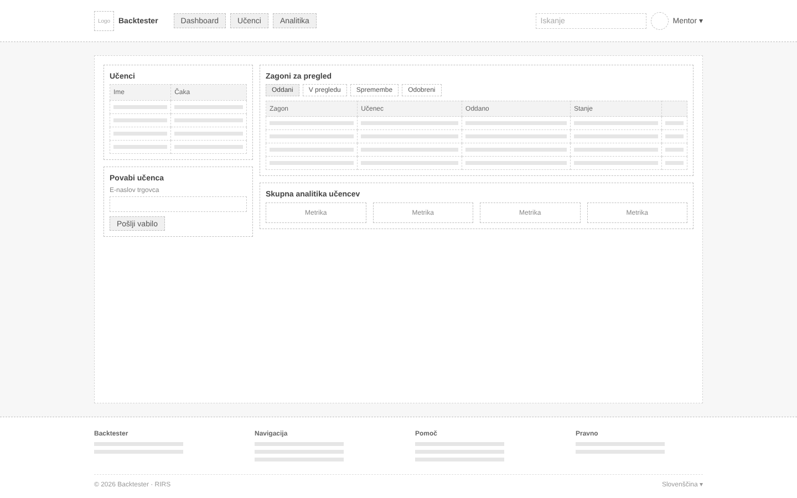
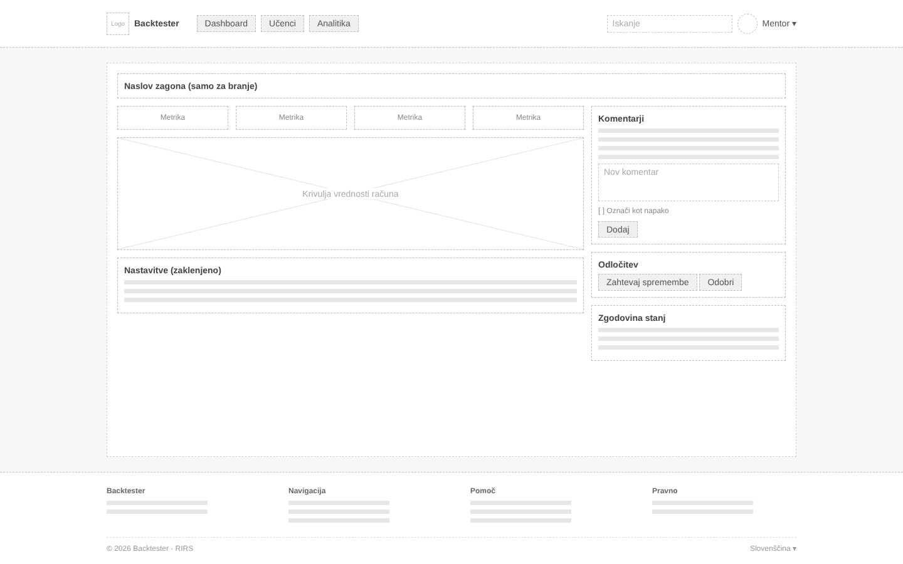

# Wireframes

## Pregled

| Oznaka | Zaslon | Vloga | Zgodbe |
|---|---|---|---|
| WF-01 | Prijava in registracija | vsi | US-01, US-02 |
| WF-02 | Nov test | Trgovec | US-04, US-05, US-07, US-08 |
| WF-03 | Rezultati testa | Trgovec | US-06, US-07, US-08, US-10, US-12 |
| WF-04 | Mentorjev dashboard | Mentor | US-11, US-13, US-15 |
| WF-05 | Mentorjev pregled testa | Mentor | US-13, US-14 |
| WF-06 | Administracija | Administrator | US-16, US-17 |

---

## WF-01: Prijava in registracija

Prvi zaslon, ki ga vidi neprijavljen uporabnik. Obrazca za prijavo in registracijo sta prikazana skupaj.

1. Prijava z e-naslovom in geslom.
2. Enotno sporočilo o napaki, ki ne razkrije, ali je napačen e-naslov ali geslo.
3. Sporočilo za blokiran račun, prikazano samo ob pravilnem geslu.
4. Registracija z imenom, e-naslovom in geslom (najmanj 8 znakov).
5. Izbira vloge Trgovec ali Mentor. Vloge Administrator ni mogoče izbrati.

---

## WF-02: Nov test

Glavni delovni zaslon trgovca: nastavitev in zagon testa na enem mestu. Levo so strategija, parametri, sredstva in obdobje, desno stroški borze in financiran račun s povzetkom in gumbom za zagon.

1. Izbira strategije z filtrom Vse / Moje / Sistemske / Deljene.
2. Parametri strategije, ki jih je mogoče spremeniti samo za ta test.
3. Izbira enega ali več finančnih sredstev.
4. Obdobje s prednastavitvami ali ročnim vnosom datumov.
5. Izbira borze s prikazom provizij in razpona, ki bodo upoštevani pri testu.
6. Neobvezna izbira financiranega računa s prikazom njegovih pravil.
7. Povzetek izbire in gumb »Zaženi test«, pod njim sporočilo ob napaki validacije.

---

## WF-03: Rezultati testa

Zaslon, ki ga trgovec vidi po zagonu testa. Prikazuje rezultate, vpliv stroškov in izid preverjanja pravil financiranega računa, na dnu pa tudi odziv mentorja, ko je test oddan.

1. Glava testa z nastavitvami in stanjem testa (`draft`).
2. Dejanja: primerjava, deljenje in oddaja mentorju (aktivna samo z aktivno povezavo z mentorjem).
3. Ključne metrike: neto dobiček, donosnost, število poslov, največji padec, delež dobičkonosnih poslov.
4. Krivulja vrednosti računa z označeno prvo kršitvijo pravila financiranega računa.
5. Stroški borze: bruto dobiček, provizije, razpon in neto dobiček.
6. Preverjanje pravil financiranega računa po pravilih z izidom Izpolnjeno/Kršeno in skupnim izidom.
7. Stanje pregleda in mentorjevi komentari samo za branje, napake so označene; gumb »Ponovi test« ustvari nov test iz prejšnjega.

---

## WF-04: Mentorjev dashboard

Začetna stran mentorja. Na enem mestu so učenci, testi, ki čakajo na pregled, in zbrana statistika.

1. Seznam aktivnih učencev s številom testov in številom testov, ki čakajo na pregled.
2. Vabilo novega učenca z e-naslovom trgovca.
3. Seznam testov s filtrom po stanju (oddani, v pregledu, zahtevane spremembe, odobreni) in paginacijo.
4. Gumb »Začni pregled«, ki test premakne iz `submitted` v `in_review`.
5. Skupna analitika učencev z izbiro obdobja.

---

## WF-05: Mentorjev pregled testa

Zaslon, kjer mentor pregleda test učenca. Rezultati in parametri so samo za branje, desno pa je prostor za komentarje in odločitev.

1. Označba, da je test samo za branje; mentor ne more spreminjati parametrov in rezultatov.
2. Seznam komentarjev, ločen od ostale vsebine.
3. Komentar, označen kot napaka (rdeča oznaka).
4. Obrazec za nov komentar s kljukico »Označi kot napako«.
5. Odločitev: »Zahtevaj spremembe« (aktivno šele po vsaj enem komentarju) ali »Odobri«.
6. Zgodovina stanj testa (`status_history`), ki prikazuje, kdo je kdaj spremenil stanje.

---

## WF-06: Administracija

Zaslon administratorja za upravljanje uporabnikov in referenčnih podatkov. Isti vzorec (tabela, iskanje, obrazec za urejanje) se uporablja za sredstva, borze in pravila računov, zato je kot primer prikazana borza.

1. Seznam uporabnikov z vlogo in stanjem računa.
2. Iskanje po imenu ali e-naslovu in gumb za nov račun.
3. Blokiranje in odblokiranje računa; vloga se spreminja neposredno v tabeli.
4. Tabela borz s provizijami in razponom ter obrazec za urejanje.
5. Opozorilo, da izbris ni mogoč, če zapis uporablja vsaj en test.